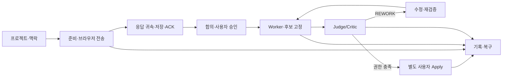

# B. 로직 블록 구조 명세

**승인용 제안 / 미반영.** 2026-11-04. 검토 소스와 증거 수준은 [A](windows-product-acceptance.proposal.md)를 따른다. 정적 코드의 책임 지도이며 현재 Windows 실행 PASS를 뜻하지 않는다.

## 책임 원칙과 연결

도메인은 수용·귀속 규칙, orchestration은 수행 순서, persistence는 영속화, runtime/extension은 외부 동작을 소유한다. UI는 서버 snapshot/capabilities의 projection이다. 블록화는 책임을 명확히 하는 것이며 파일 수를 늘리는 작업이 아니다.

연결은 데이터·권한의 흐름이다. HOLD/RECOVERY_REQUIRED에서 자동 수행을 승인하는 그림이 아니다.

## 블록별 책임·전이·복구

| 블록 | 책임·정본 소유자 | 입력 | 확정 출력 | 상태 전이·연결 | 실패 경계와 복구 책임 |
|---|---|---|---|---|---|
| B01 프로젝트·맥락 | audit-project-settings/project-activity, PreparationService; 런 조회는 CodeChangeStore | objective/targetRoot·요구사항 버전·선택 runId | 설정·이전 기록·현재 preparation/run 연결 | START/START_IDLE; 조회와 재개 권한 구분 | dirty/다른 경로·오래된 설정은 거절/명시적 조회. service가 정본, UI는 선택·버전 재검증 |
| B02 준비·전송 | PreparationService 예약, WebSessionAdapter/transport 요청, extension storage/content 실제 탭 | preparationId/version·binding/session·deliveryId·사용자 원문 | 영속 예약·외부 turn handle·dispatch 관측 | RESERVED→DISPATCHING→SUBMITTED→RESPONSE_STARTED; 첫 확정 응답 전 UI는 START | 전송 전 실패와 dispatch 후 미확정 구분. 소유자 유지, 사용자는 inspect/reconcile 뒤 결정 |
| B03 응답·귀속 | PreparationService validation/ACK, reviewer receipt; DISCUSSION은 DiscussionController binding/response | run/session/delivery/turn/conversation/document/message·응답 envelope | 유효/거절 응답 아티팩트·저장 receipt·ACK | RESPONSE_COMPLETED→처리 ACK_PENDING→ACKNOWLEDGED/COMPLETE; ACK 뒤 active 해제 | wrong ID·중복·변조·저장 실패는 거절/RECOVERY_REQUIRED. persistence가 응답 보존, adapter는 정해진 ACK만 |
| B04 합의·승인 | PreparationService.execute + startPrepared callback | READY 합의·expectedVersion·command requestId | reservedRunId→resultingRunId, 동결 요구사항·receipt | DISCUSSING→AGREEMENT_READY→APPROVING→WORK | 동일 ID 다른 명령 거절. 승인 중 실패/재시작은 reserved ID와 receipt로 동일 Run 확인 |
| B05 Worker·후보 | CodeChangeService·registered worker·GitChangeWorkspace·artifact store | 승인 요구사항·work order·baseCommit·등록 검증 | 실제 thread/turn·capture·candidate/tree/patch/hash·증거 | PROVISIONING→WORKER_RUNNING→CANDIDATE_CAPTURE→VERIFYING | claim≠capture≠검증. 취소·한도·target drift 시 후속 배정 차단; 각 자원 owner가 종료 확인 |
| B06 독립 감사 | audit-round; audit-manifest/review-coordination/code-review 도메인; 역할 어댑터 | 같은 후보/evidence/findings/requirements manifest·별도 role binding | 독립 대화의 reasoning/assertions·manifest-bound 판정 | REVIEW_RUNNING 및 role/round coordination; PASS/REWORK/HOLD; REPORT_REPAIR는 같은 후보 | 동일 대화·ID 불일치·로그인 실패·판단 불가 시 HOLD/REPAIR. coordinator가 후보를 임의 변경하지 않음 |
| B07 수정·재검증 | CodeChangeService.executeIterations·audit-round·candidate-evidence; domain/code-review | findings·agreed work order·등록 검사 | 새 후보/증거/재감사, 강제된 Apply 차단 | REWORK→WORKER_RUNNING→VERIFYING→REVIEW_RUNNING; supplement는 같은 후보 | OPEN/필수 FAIL/UNDETERMINED/증거 변경은 PASS 불가. Controller가 권한 검사, operator 우회 없음 |
| B08 명시적 Apply | CodeChangeService.command(code.apply)·GitChangeWorkspace.apply·Store | 사용자 requestId·expectedVersion·candidate/review/artifactHash/baseCommit | applicationId·실제 tree·APPLIED 기록 | AWAITING_APPLY→APPLYING→APPLIED 또는 RECOVERY_REQUIRED | clean/base/tree 검사. 재시작에 기준/정확 후보/다른 상태 구분; 자동 재적용·commit/push 없음 |
| B09 종료·재시작·복구 | server.closeSteps·각 worker/process owner·service.recover/reconcile·delivery recovery | stop/restart/disconnect·저장 상태·실제 PID/handle/target | 종료·해제 증거 또는 RECOVERY_REQUIRED와 원인 | STOPPING≠CANCELLED; active 재시작→복구 필요; reconcile read-only | 자원 owner가 close 확인, service가 재배정 차단. abandon의 operator attest는 외부 종료 자동 증명 아님 |

## 유지할 구조와 개선 제안

1. Preparation↔CODE_CHANGE 연결은 reservedRunId/resultingRunId로 이미 존재한다. 저장소를 합치거나 새 workflow service를 만들지 않는다. callback 실패 시 같은 reserved Run 조회로 복구하며 UI가 새 Run을 추정하지 않는다.
2. DISCUSSION의 RunPhase는 domain/run-state-machine.js, CODE_CHANGE stage는 code-change-service/audit-round, preparation state는 preparation-service가 소유한다. 하나의 FSM으로 합치지 않는다. CANONICAL_OWNERSHIP의 전이 소유권은 해당 bounded context를 명시하도록 정정한다.
3. UI 모델·app.js의 역할은 projection과 명령 전달이다. 동일 문자열이나 파일 중복만으로 책임 충돌을 단정하지 않는다. 실제 권한 판정 충돌이 관측될 때만 좁혀 개선한다.
4. WORKFLOW_CONTRACT의 첫 응답 전 START 유지 단락과 PREPARE 대기 단락은 모순될 수 있다. 현재 preparation-service.project의 connecting 분기는 START를 반환한다. 공개 workflow.stage/state와 내부 context.stage/state를 문서에서 구분한다. 코드 수정 제안은 아니다.
5. Judge는 CHATGPT_WEB 구성에서 준비 대화를 재사용할 수 있지만 Critic과는 다른 대화여야 한다. 독립성은 모든 역할에 매번 새 탭을 강제하는 조건이 아니라 실제 reviewer conversation·동일 manifest·귀속 검사다.
6. 원본 history와 UI snapshot은 다른 역할이다. UI/진단에서 별도 정본 전이 규칙이나 새 authority를 정의하지 않는다. 기능 삭제·파일 분할·전면 재작성을 제안할 근거가 없다.

## 코드 근거

- [준비 소유자](../../../src/orchestration/preparation-service.js), [프로젝트 기록](../../../src/orchestration/project-activity.js), [설정](../../../src/orchestration/audit-project-settings.js)
- [CodeChangeService](../../../src/orchestration/code-change-service.js), [감사 조정](../../../src/orchestration/audit-round.js), [감사 판정](../../../src/domain/code-review.js), [manifest](../../../src/domain/audit-manifest.js)
- [DISCUSSION 전이](../../../src/domain/run-state-machine.js), [리뷰 합의](../../../src/domain/review-coordination.js), [명령 receipt](../../../src/orchestration/dashboard-controller.js)
- [Worker](../../../src/runtime/code-change-worker.js), [Git 작업 사본·Apply](../../../src/repository/git-change-workspace.js), [응답·ACK receipt](../../../src/orchestration/web-delivery-receipts.js)
- [저장·이력](../../../src/persistence/code-change-store.js), [서버 종료](../../../src/server.js), [복구 계약](../../RECOVERY_RECONCILIATION.md)

이미 명확한 경계는 유지한다. 변경 목적은 소유권을 읽을 수 있게 하는 것이며 새 추상화 계층 추가가 아니다.
